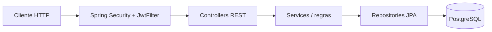

# Arquitetura

**Segurança:** rotas públicas coerentes com SecurityConfig; rotas protegidas aceitam somente os tipos de JWT adequados. A falha de validação limpa o SecurityContext e delega o erro ao HandlerExceptionResolver.

**Persistência:** entidades JPA com PostgreSQL; migrar alterações de schema de maneira controlada antes de produção. Não supor integração ativa com a versão Supabase do projeto.
