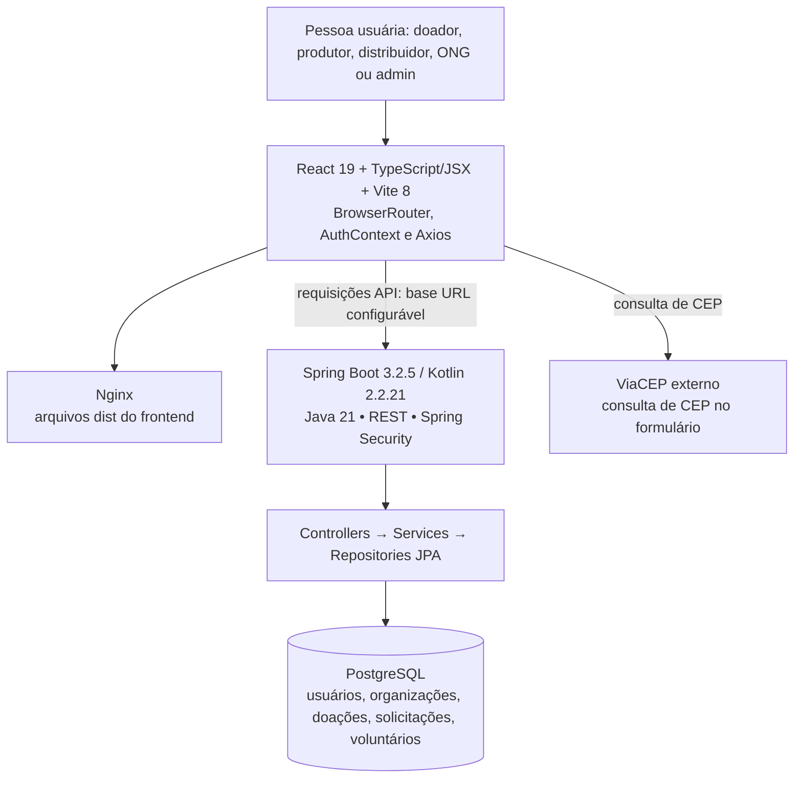
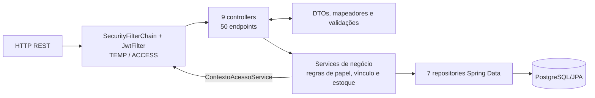
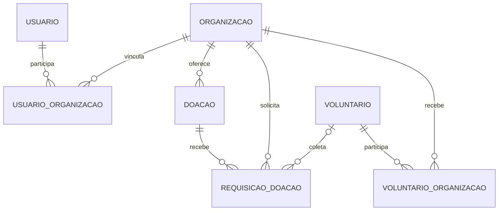
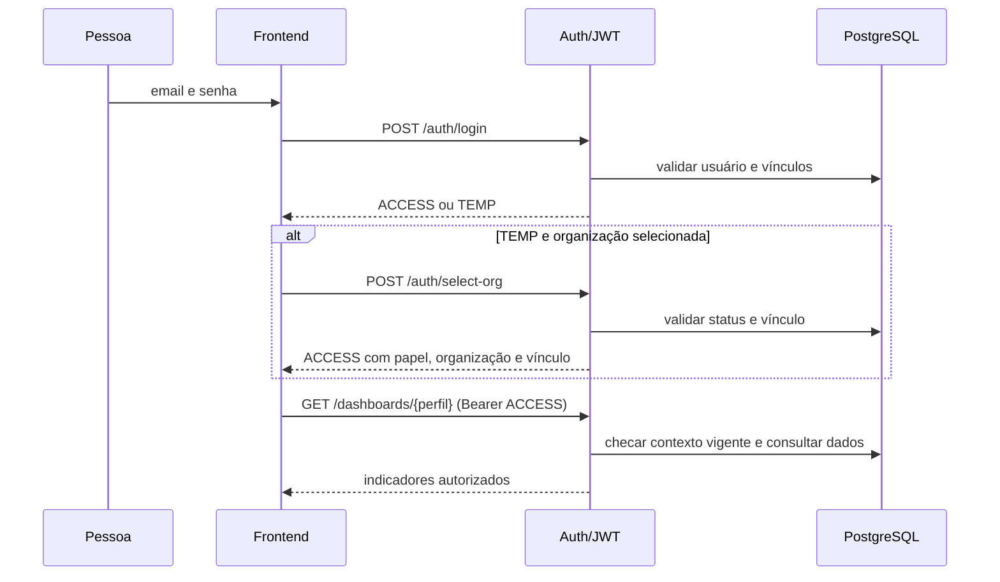
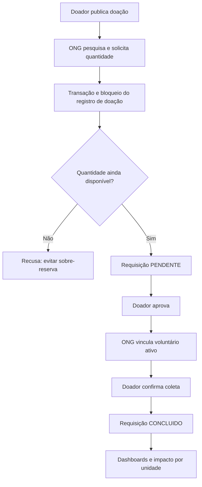
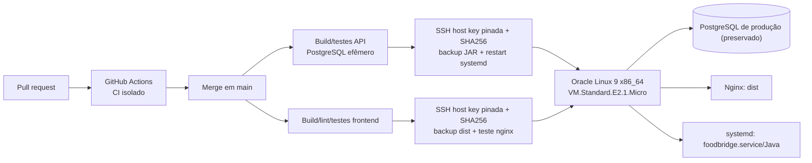

# FoodBridge — arquitetura técnica atual

> **FB-ARC-ATUAL-001 · 13/11/2026.** Descreve os componentes observados em código e nos workflows homologados. Distingue execução comprovada de decisões não verificadas externamente.

## Escopo da infraestrutura

Estão representados **apenas os componentes usados diretamente pelo FoodBridge**: frontend React, Nginx, API Kotlin/Spring Boot, PostgreSQL, SSH/CI/CD e integrações efetivas do produto. A instância Oracle é compartilhada, porém não é objetivo deste documento inventariar outras aplicações hospedadas nela.

## Visão de camadas

**Cuidado:** Nginx servindo `dist` e API respondendo em `127.0.0.1:8080` foram comprovados em VM. O encaminhamento público de todos os caminhos API pelo Nginx **não** foi homologado por teste de integração externo abrangente; confirmar a configuração da instância e `VITE_API_BASE_URL` em cada ambiente.

## Arquitetura interna do backend

`config/` inclui CORS, segurança, JWT, encoder, inicialização administrativa, guarda de validação de esquema e WebConfig. A app tem `GlobalExceptionHandler`, exceções customizadas e `JwtService`. A validação do tenant acontece nos serviços e consulta vínculos vigentes, não apenas claims JWT.

## Modelo de dados e relacionamentos

- `Usuario`: nome, email, senha com encoder, status e vínculos.
- `Organizacao`: CNPJ, nome, email, categoria/papel, estado de aprovação e endereço JSONB.
- `UsuarioOrganizacao`: papel, status e datas da relação usuário-organização.
- `Voluntario`: contato, CPF, endereço JSONB; `VoluntarioOrganizacao`: vínculo e estado.
- `Doacao`: categoria, unidade, quantidade, vencimento, endereço JSONB, janelas de horário JSONB, status, quantidade final coletada e fechamento.
- `RequisicaoDoacao`: doação, organização solicitante, voluntário opcional, quantidade solicitada, status e datas.
- `Endereco` e `JanelaHorario` são objetos de valor, não entidades JPA independentes.

Esquema físico real e constraints adicionais devem ser verificados por inspeção/migrações, não deduzidos integralmente do diagrama lógico. O projeto usa `ddl-auto=validate` ou `none` para produção: o CI cria banco descartável, **não** recria PostgreSQL da Oracle.

## Fluxos principais

### Login, contexto organizacional e acesso

### Reserva de estoque até coleta

As transições `PENDENTE`, `APROVADO`, `CONCLUIDO`, `REJEITADO` e `CANCELADO` são definidas no código. `DoacaoService` admite fechamento manual e evita totalizar quantidades de unidades incompatíveis.

## Implantação na mesma Oracle E2.1.Micro

- Backend: CI `foodbridge-ci-cd.yml` compila e testa em PostgreSQL de teste, depois publica JAR aprovado em push de código na `main`.
- Frontend: `deploy.yml` testa, compila, envia `dist` e confirma Nginx HTTP 200. Repositórios e environments de segredos são separados.
- A E2.1.Micro reconhece ~945 MiB após Kdump ser desabilitado pelo operador; telemetria de memória é alerta, não mais veto de deploy.
- Health: `GET /health/live` leve e `GET /dashboards/publico` com consulta real. Backups prévios e rollback tentado automaticamente em falha.
- Sem Kubernetes, alta disponibilidade, replicação declarada nem HTTPS homologado nestes workflows; tratá-los como futuras melhorias.

## Segurança e decisões técnicas

O frontend guarda sessão em `localStorage`, e isso demanda proteção contra XSS e futura revisão da estratégia de tokens. O backend usa `JwtFilter` + verificação de usuário e vínculo no banco; `Spring Security` exige papéis e tokens. Dados pessoais de usuários e voluntários requerem minimização de acesso e políticas LGPD — o repositório não é certificado de conformidade jurídica.

Para diagramas PlantUML legados editáveis, veja [docs/uml/README.md](uml/README.md); para contratos HTTP, [referência API](REFERENCIA_API_ATUAL.md).
