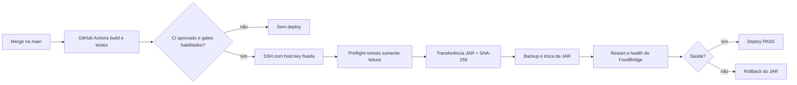

# FoodBridge — entrega direta do GitHub Actions via SSH

**FB-OCI-SSH-CD-003 · 13/11/2026 · CI/CD com primeiro deploy manual e auto-deploy opt-in.**

## Estado comprovado

- GitHub Actions da API realizou autenticação RSA dedicada, `SSH_RSA_OK`, `SSH_EXIT=0` e `PREFLIGHT ORACLE: PASS` no run [43355411573](https://github.com/DanieldeAlmeida2024/FoodBridge-API-Kotlin/actions/runs/43355411573), última tentativa, job 131848870328, em 13/11/2026. Sem deploy.
- Runtime na VM: Oracle Linux 9, SSH `opc`, `/etc/foodbridge/application.properties`, `foodbridge.service`, JAR em `/opt/foodbridge/FoodBridge-API-Kotlin/build/libs/foodbridge-0.0.1-SNAPSHOT.jar`, PostgreSQL existente. Preflight confirmou `ddl-auto` não mutante.
- O endpoint `/dashboards/publico` respondeu em **7,684649 s** na VM, acima do limiar de alerta de 5 s; o limite de 20 s evita falso rollback, mas recomenda investigar consultas e usar `/health/live` leve em versão futura.
- Firewall da VPC atualmente aberto para TCP/22 de `0.0.0.0/0` por decisão do mantenedor; **o workflow não altera regras de rede**. Isso expõe o SSH a tentativas de toda a internet. Manter key-only, senha e root login bloqueados se esses controles já tiverem sido verificados; nunca mudar `sshd` sem plano de recuperação.

## Estrutura do pipeline homologável



Workflow `.github/workflows/foodbridge-ci-cd.yml`: `build-e-testes` usa PostgreSQL descartável, Java 21 e valida os contratos. O job `deploy-oracle` executa somente **após sucesso desse job**, na `main`. Para publicação manual, exige `OCI_DEPLOY_ENABLED=true`, dispatch `deploy=true` e `preflight=false`. Para push automático, exige explicitamente **ambos** `OCI_DEPLOY_ENABLED=true` e `OCI_AUTO_DEPLOY_ENABLED=true`. O default é bloqueado.

## Variáveis e credenciais no GitHub

- No repositório **API**, o environment `oracle-production` já possui `OCI_SSH_HOST`, `OCI_SSH_USER`, secret `OCI_SSH_PRIVATE_KEY` e `OCI_SSH_KNOWN_HOSTS`, homologados pelo preflight; não recriar a chave nem imprimir secrets.
- **Flags do job** devem ser configuradas como **variáveis do repositório** (não apenas do environment), pois são avaliadas antes de o job entrar no environment: `OCI_DEPLOY_ENABLED`, `OCI_AUTO_DEPLOY_ENABLED`.
- No repositório **frontend**, os secrets/variables pertencem a outro repositório e precisam ser provisionados separadamente pelo script `deploy/oracle/preparar-secrets-ssh-windows.ps1` de lá. O job usa os mesmos nomes `OCI_SSH_*` e a mesma chave dedicada validada.
- Proteger o environment `oracle-production` e a `main` conforme as opções disponíveis; não usar credenciais de produção em PRs.

## Gate 1 — primeira publicação API manual

Executar no **CMD do Windows já autenticado com `gh`**, após CI da branch de SSH concluído e merge em `main`:

```bat
gh variable set OCI_DEPLOY_ENABLED --body true --repo DanieldeAlmeida2024/FoodBridge-API-Kotlin
gh variable set OCI_AUTO_DEPLOY_ENABLED --body false --repo DanieldeAlmeida2024/FoodBridge-API-Kotlin
gh workflow run foodbridge-ci-cd.yml --ref main -f preflight=false -f deploy=true --repo DanieldeAlmeida2024/FoodBridge-API-Kotlin
gh run list --workflow foodbridge-ci-cd.yml --limit 5 --repo DanieldeAlmeida2024/FoodBridge-API-Kotlin
```

Verificar no log `Pré-flight obrigatório ...` e `DEPLOY OK: API respondeu ...`; o novo JAR deve ter checksum, backup e rollback automático em falha. **O restart substitui código da API e pode causar indisponibilidade; o script não substitui configurações ou dados SQL.** Ter backup do banco válido e migrações compatíveis antes de publicar.

## Gate 2 — primeira publicação frontend manual

Depois de configurar o environment `oracle-production` no frontend e aprovar o preflight `oracle-frontend-preflight.yml`:

```bat
gh variable set OCI_DEPLOY_ENABLED --body true --repo DanieldeAlmeida2024/Foodbridge-Frontend-React
gh variable set OCI_AUTO_DEPLOY_ENABLED --body false --repo DanieldeAlmeida2024/Foodbridge-Frontend-React
gh workflow run deploy.yml --ref main -f deploy=true --repo DanieldeAlmeida2024/Foodbridge-Frontend-React
gh run list --workflow deploy.yml --limit 5 --repo DanieldeAlmeida2024/Foodbridge-Frontend-React
```

O workflow repete testes, lint e build; confirma fingerprint SSH, transmite o pacote para `/tmp`, verifica SHA-256 no destino e executa `deploy/oracle/atualizar-frontend.sh` com backup e restauração em erro. Verificar frontend também no domínio público após sucesso do job; `nginx -t` por si só não valida HTTP.

## Gate 3 — habilitar publicação automática

**Somente depois de ambos os primeiros deploys manuais e smoke tests PASS:**

```bat
gh variable set OCI_AUTO_DEPLOY_ENABLED --body true --repo DanieldeAlmeida2024/FoodBridge-API-Kotlin
gh variable set OCI_AUTO_DEPLOY_ENABLED --body true --repo DanieldeAlmeida2024/Foodbridge-Frontend-React
```

Cada push à `main` disparará os respectivos jobs; o backend depende do build/testes e o frontend executa testes+lint+build no próprio job. `cancel-in-progress: false` evita interromper substituições e rollback.

## Parar imediatamente futuras publicações

```bat
gh variable set OCI_AUTO_DEPLOY_ENABLED --body false --repo DanieldeAlmeida2024/FoodBridge-API-Kotlin
gh variable set OCI_AUTO_DEPLOY_ENABLED --body false --repo DanieldeAlmeida2024/Foodbridge-Frontend-React
gh variable set OCI_DEPLOY_ENABLED --body false --repo DanieldeAlmeida2024/FoodBridge-API-Kotlin
gh variable set OCI_DEPLOY_ENABLED --body false --repo DanieldeAlmeida2024/Foodbridge-Frontend-React
```

Desligar flags não reverte versões já implantadas. Não executar `git reset --hard`, `DROP`, `pg_restore`, nem reiniciar PostgreSQL como método genérico de rollback. Não fazer push apenas para repetir um deploy quando `workflow_dispatch` é suficiente.

## Evidência ainda necessária

- CI de pull request com testes contratuais e sintaxe PASS e CI de push/main após merge.
- Preflight frontend real por GitHub Actions: arquivo, dono/permissões de `dist`, Nginx ativo e autenticação SSH.
- Variáveis e secrets do **frontend** configurados no ambiente correto.
- Primeiro deploy manual de API e web com logs, SHA, backup e comportamento observado no domínio.
- Só depois, auto-deploy e teste de um push futuro com atualização visível.

Alternativa não selecionada nesta operação: `docs/implantacao/CI_CD_POR_ARTEFATOS.md` (agente local de pull). Nenhum timer desse mecanismo deve ser instalado ou habilitado junto do caminho SSH direto.
